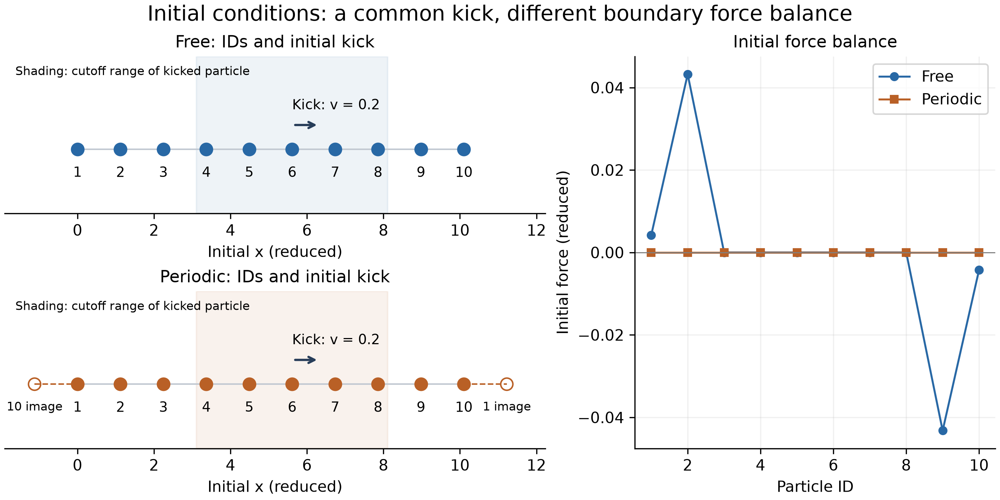
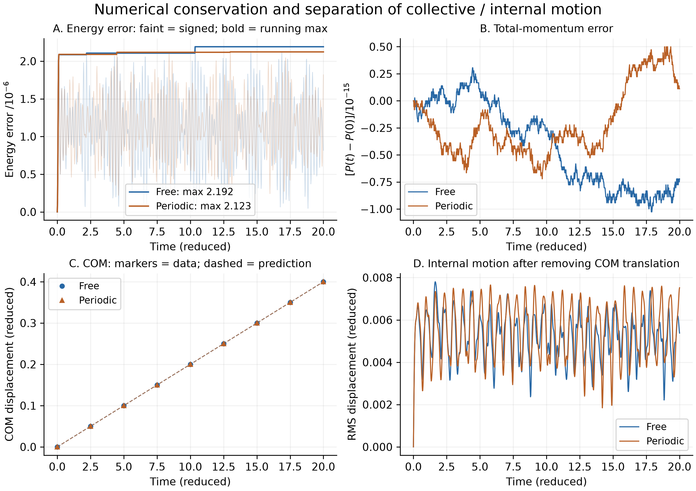
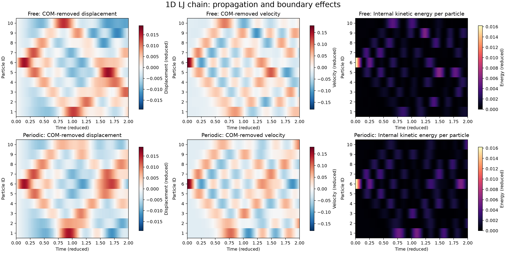
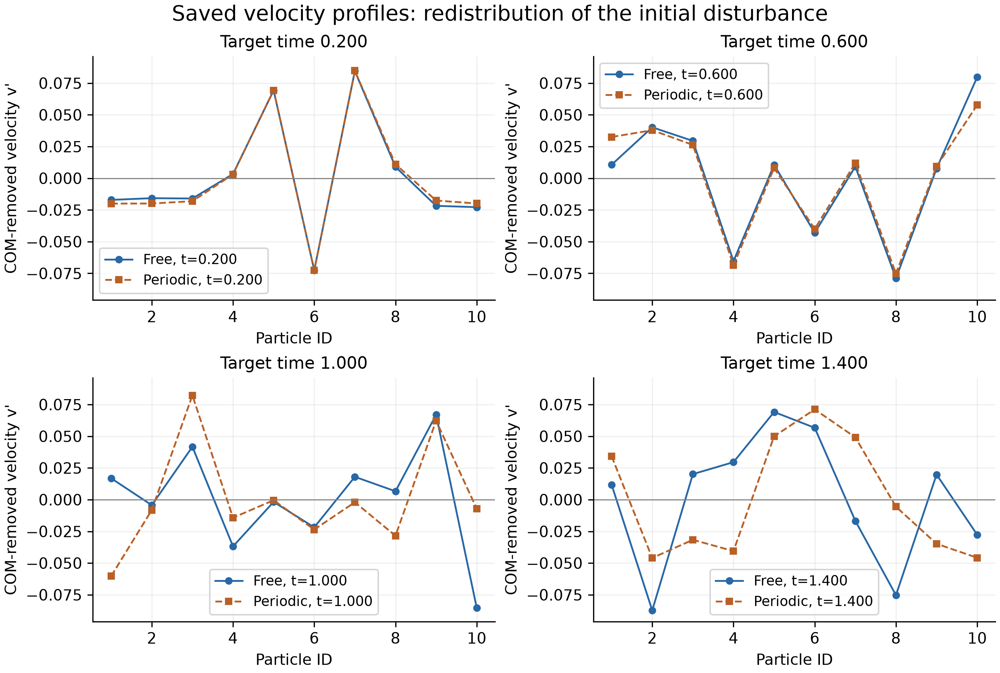
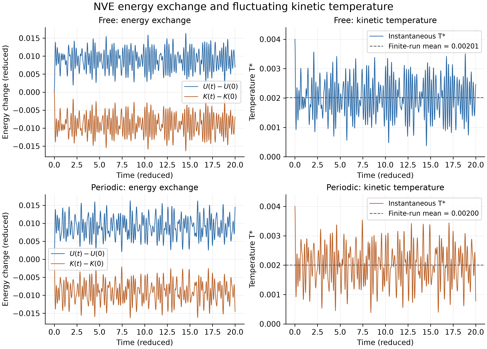
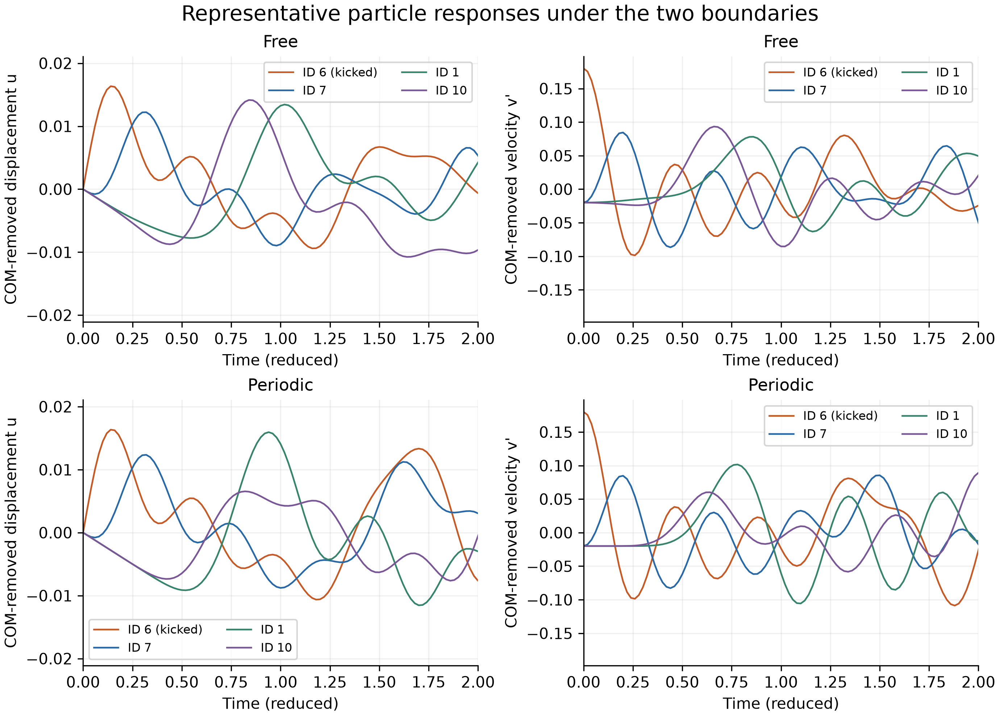
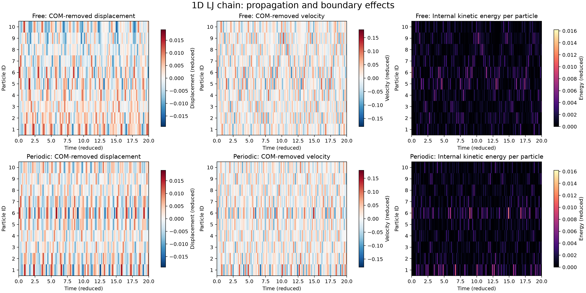

## 1. 实验目的与研究问题

**实验名称：一维 Lennard-Jones 粒子链的分子动力学模拟——自由边界与周期边界的比较。**

本实验在课程一维简谐振子程序的基础上，将单粒子运动扩展为由 10 个粒子构成的一维系统，使用 Lennard-Jones（LJ）势描述粒子间相互作用，并分别采用自由边界和周期边界进行模拟。通过保存位置、速度、受力及热力学量，分析局部速度扰动引起的运动、能量交换与温度变化。

实验围绕以下研究问题展开：

1. 采用 Velocity Verlet 算法时，系统总能量和总动量能否在观测时段内保持良好守恒？
2. 非零初始总动量引起的整体平移，与粒子之间的内部振动应如何区分？
3. 在相同初始位置和速度条件下，自由边界与周期边界对应的粒子响应、空间波形和动力学温度有什么差异？

两种边界采用相同的初始位置、初始速度和积分参数，均进行无外力、无恒温器的动力学模拟。

## 2. 物理模型与数值方法

### 2.1 相互作用势与边界条件

系统中各粒子质量相同，仅沿 $x$ 方向运动。粒子间的原始 LJ 势为

$$
U_{\mathrm{LJ}}(r)=4\epsilon\left[\left(\frac{\sigma}{r}\right)^{12}-\left(\frac{\sigma}{r}\right)^6\right],
$$

其中，$r$ 为粒子间距，$\epsilon$ 决定能量尺度，$\sigma$ 决定长度尺度。短距离下的排斥项避免粒子重叠，较远距离下的吸引项使粒子能够形成相互耦合的链状系统。

定义向外为正的径向力为

$$
F_{\mathrm{LJ}}(r)=-\frac{\mathrm{d}U_{\mathrm{LJ}}}{\mathrm{d}r}
=\frac{24\epsilon}{r}\left[2\left(\frac{\sigma}{r}\right)^{12}-\left(\frac{\sigma}{r}\right)^6\right].
$$

本实验取截断半径 $r_c=2.5\sigma$。为避免直接截断导致势能和力在截断处不连续，采用力移位截断（shifted-force）方法：

$$
U_{\mathrm{SF}}(r)=
\begin{cases}
U_{\mathrm{LJ}}(r)-U_{\mathrm{LJ}}(r_c)+(r-r_c)F_{\mathrm{LJ}}(r_c), & r<r_c,\\
0, & r\geq r_c,
\end{cases}
$$

$$
F_{\mathrm{SF}}(r)=
\begin{cases}
F_{\mathrm{LJ}}(r)-F_{\mathrm{LJ}}(r_c), & r<r_c,\\
0, & r\geq r_c.
\end{cases}
$$

程序遍历所有 $i<j$ 的粒子对，对两个粒子施加大小相等、方向相反的作用力，并将每对势能累计一次。设从粒子 $i$ 指向粒子 $j$ 的有符号位移为 $d_{ij}$，则作用在粒子 $i$ 上的该对作用力为

$$
F_{i\leftarrow j}=-F_{\mathrm{SF}}(\lvert d_{ij}\rvert)\operatorname{sgn}(d_{ij}).
$$

两种边界的处理方式如下：

- **自由边界：** 直接使用 $d_{ij}=x_j-x_i$。系统没有固定盒壁，也不对端部粒子施加位置约束。
- **周期边界：** 采用一维最小镜像距离

$$
d_{ij}=x_j-x_i-L\left\lfloor\frac{x_j-x_i}{L}+\frac{1}{2}\right\rfloor,
$$

其中 $L$ 为周期盒长。位置更新后将坐标折回 $[0,L)$，同时记录跨界次数，保存连续坐标。截断半径满足 $r_c<L/2$，保证使用最小镜像计算截断内相互作用。

### 2.2 时间积分与热力学量定义

时间积分沿用课程简谐振子示例中的 Velocity Verlet 思路。首先更新位置：

$$
x_i(t+\Delta t)=x_i(t)+v_i(t)\Delta t+\frac{1}{2}a_i(t)\Delta t^2.
$$

随后根据新位置计算作用力与加速度，再更新速度：

$$
v_i(t+\Delta t)=v_i(t)+\frac{\Delta t}{2}\left[a_i(t)+a_i(t+\Delta t)\right].
$$

系统总势能、总动能和总能量分别为

$$
E_p=\sum_{i<j}U_{\mathrm{SF}}(r_{ij}),\qquad
E_k=\frac{1}{2}m\sum_i v_i^2,\qquad
E_t=E_p+E_k.
$$

为区分整体平移与内部运动，定义质心速度和去质心速度：

$$
v_{\mathrm{COM}}=\frac{1}{N}\sum_i v_i,\qquad
v_i'=v_i-v_{\mathrm{COM}}.
$$

扣除一维质心平移自由度后，动力学温度定义为

$$
T=\frac{m\sum_i(v_i')^2}{(N-1)k_B}.
$$

总动能包含质心平移能，而温度由去质心动能计算。单粒子内部动能定义为

$$
K_i'=\frac{1}{2}m(v_i')^2.
$$

### 2.3 初始化、模拟参数与程序流程

本实验使用 LJ 约化单位：长度、能量、质量和时间单位分别为 $\sigma$、$\epsilon$、$m$ 和 $\sigma\sqrt{m/\epsilon}$。取 $\epsilon=\sigma=m=k_B=1$，温度以约化温度 $T^*=k_BT/\epsilon$ 表示。下文中的数值均使用约化单位。

| 参数 | 设置 |
| --- | --- |
| 粒子数 $N$ | 10 |
| 初始间距 $a$ | $2^{1/6}\sigma\approx1.12246$ |
| 初始位置 | $x_i(0)=(i-1)a$，$i=1,\ldots,10$ |
| 初始速度 | 第 6 个粒子为 0.2，其余为 0 |
| 截断半径 $r_c$ | 2.5 |
| 周期盒长 $L=Na$ | 约 11.22462 |
| 积分步长 $\Delta t$ | 0.002 |
| 总积分步数 | 10000 |
| 总模拟时间 | 20 |
| 输出间隔 | 每 10 步保存一次，时间间隔为 0.02 |
| 保存帧数 | 包含初态和终态，共 1001 帧 |

在初始构型下，最近邻和次近邻距离分别约为 1.12246 和 2.24492，均小于截断半径；第三近邻距离约为 3.36739，超过截断半径。初态的相互作用因此包含最近邻和次近邻两部分。

程序首先初始化位置和速度、计算初始受力，再逐步更新位置、受力和速度，每 10 步记录一次状态。位置、速度和力的采样历史分别保存为形状为 $(1001,10)$ 的二维数组，行对应采样时刻，列对应固定粒子编号。热力学信息写入 CSV 文件，轨迹与参数保存为 NPZ 文件，随后使用 matplotlib 绘图。

**图 1** 两种边界下的初始排列、速度扰动与初始受力。空心粒子表示周期镜像，浅色区域表示被扰动粒子的初始截断邻域。

初始间距 $2^{1/6}\sigma$ 是原始双粒子 LJ 势的最低点，但不是本实验自由链的精确平衡间距。图 1 表明，自由链边缘区域的初始受力不为零，最大受力幅值约为 0.04322；周期等距链中，每个粒子的左右作用相互抵消，初始受力均为零。

因此，自由链的运动同时包含局部速度扰动引起的响应和初始构型的边缘松弛。

## 3. 数值验证

### 3.1 总能量与总动量守恒

以总能量和总动量检验积分结果。以下误差均由 1001 个保存帧统计。定义

$$
\Delta E(t)=E_t(t)-E_t(0),\qquad
P(t)=m\sum_i v_i(t),\qquad
\Delta P(t)=P(t)-P(0).
$$

**图 2** 数值守恒与整体、内部运动的区分。A：浅色曲线为带符号能量误差，粗线为截至当前时刻的最大绝对误差；B：总动量误差；C：质心位移数据与匀速运动预测；D：去质心位移的均方根。

| 检查量 | 自由边界 | 周期边界 |
| --- | ---: | ---: |
| 初始总能量 | -8.38756777 | -9.32700990 |
| 最大绝对总能量误差 | $2.192\times10^{-6}$ | $2.123\times10^{-6}$ |
| 初始总动量 | 0.2 | 0.2 |
| 最大绝对总动量误差 | $1.027\times10^{-15}$ | $7.216\times10^{-16}$ |

两种边界的总能量误差在观测时段内保持在约 $2\times10^{-6}$ 的量级，没有出现明显持续增长。初始内部动能为 0.018，最大能量误差约占其 0.012%，说明相对于实际扰动能量，积分误差也较小。总动量误差约为 $10^{-15}$，处于浮点舍入误差量级。

周期边界增加了跨边界的相互作用粒子对，使初始势能更低，因此两种边界的初始总能量不同。各自运行中的能量变化均很小，表明当前步长下具有良好的能量守恒性。

### 3.2 质心平移与内部振动

初始仅有一个粒子速度为 0.2，因此

$$
P(0)=0.2,\qquad v_{\mathrm{COM}}=\frac{P(0)}{Nm}=0.02.
$$

根据总动量守恒，质心应做匀速运动：

$$
x_{\mathrm{COM}}(t)-x_{\mathrm{COM}}(0)=0.02t.
$$

在 $t=20$ 时，预测质心位移为 0.4。两种边界的测量结果均约为 0.4，与预测一致。

定义相对于初态、扣除质心平移后的粒子位移为

$$
u_i(t)=x_i^{\mathrm{unwrapped}}(t)-x_i^{\mathrm{unwrapped}}(0)
-\left[x_{\mathrm{COM}}(t)-x_{\mathrm{COM}}(0)\right].
$$

其中，$x_i^{\mathrm{unwrapped}}$ 为计入跨界次数后的连续坐标。图 2D 中的内部位移尺度为

$$
u_{\mathrm{RMS}}(t)=\sqrt{\frac{1}{N}\sum_i u_i(t)^2}.
$$

保存帧中的最大单粒子去质心位移在自由边界下约为 0.01670，在周期边界下约为 0.01917，均明显小于整体质心位移 0.4。这表明，绝对位置变化主要包含整体漂移，扣除该平移后才能清晰辨认内部振动。

## 4. 粒子运动与边界效应

### 4.1 局部激励后的空间响应

**图 3** 前 2 个约化时间单位内的时空分布。上、下两行分别为自由边界与周期边界，三列依次为去质心位移、去质心速度和单粒子内部动能。对应物理量在两种边界下使用相同色标。

图 3 中，第 6 个粒子附近首先出现较强的速度和位移变化，随后其他位置的响应逐渐增强，正、负速度和位移区域交替出现。这表明局部激励通过粒子间相互作用引起了全链的耦合振动。

初态下，第 6 个粒子的去质心速度为 $0.2-0.02=0.18$，其余粒子均为 $-0.02$。图中的微弱初始背景来源于这一质心速度扣除，后续响应则表现为相对于初始背景的速度和位移变化。

### 4.2 相同时刻的波形比较

**图 4** 在 $t=0.2$、0.6、1.0 和 1.4 时，两种边界下的去质心速度空间分布。数据点表示各粒子的速度，连线用于显示空间分布。

在 $t=0.2$ 时，被扰动粒子及其邻近区域的两种速度分布较接近；在后续时刻，部分粒子的响应和整体波形出现明显差异。例如，ID 10 的去质心速度为：

| 时刻 | 自由边界 | 周期边界 |
| --- | ---: | ---: |
| $t=0.6$ | 约 0.0797 | 约 0.0578 |
| $t=1.0$ | 约 -0.0853 | 约 -0.0071 |

这说明，在相同初始位置与速度下，边界条件改变了后续粒子运动。自由链的端部缺少跨边界邻居，而周期链首尾通过周期镜像相互作用，因此二者的作用环境及后续耦合响应不同。

自由链在局部激励的同时发生边缘松弛，且第 6 个粒子左侧有 5 个间隔、右侧有 4 个间隔，使两端响应具有不同的初始作用环境和传播距离。周期边界下，ID 1 与 ID 10 直接相邻。图 3 和图 4 展示的差异反映了这些边界条件对后续耦合运动的共同影响。

## 5. 能量交换与动力学温度

### 5.1 动能与势能的交换

**图 5** 两种边界下的能量交换与动力学温度。左列为相对于初态的势能、总动能变化；右列为扣除质心平移后的瞬时温度。虚线为整个观测区间内按时间加权的温度平均值。

初始总动能为

$$
E_k(0)=\frac{1}{2}\times0.2^2=0.02.
$$

其中质心平移能为

$$
E_{k,\mathrm{COM}}=\frac{1}{2}Nm v_{\mathrm{COM}}^2=0.002,
$$

因此初始内部动能为 0.018。模拟过程中，质心平移能基本保持不变，内部运动则伴随动能与势能之间的交换。

图 5 左列显示，势能相对于初态增加时，动能相应减小，二者的变化量基本相互抵消。这与第 3 节的总能量守恒结果一致，说明运动过程中主要发生系统内部的能量转换。

### 5.2 温度波动与有限时段平均值

由初始内部动能可得，两种边界的初始温度均为

$$
T^*(0)=\frac{2\times0.018}{10-1}=0.004.
$$

模拟中温度持续波动。定义观测时段内的时间平均温度为

$$
\overline{T^*}=\frac{1}{t_f-t_0}\int_{t_0}^{t_f}T^*(t)\,\mathrm{d}t
$$

对保存数据采用梯形积分估计时间平均值，得到以下结果。最大值和最小值也由保存帧统计。

| 温度统计量 | 自由边界 | 周期边界 |
| --- | ---: | ---: |
| 初始温度 | 0.004000 | 0.004000 |
| 最小温度 | 约 0.000372 | 约 0.000384 |
| 最大温度 | 0.004000 | 0.004000 |
| 全程时间平均温度 | 约 0.002012 | 约 0.002001 |

温度随内部动能变化而波动。初始内部动能的一部分转化为势能后，温度低于初值；随后随着能量继续交换，温度反复升降。

两种边界的时间平均温度较接近，但图 3、图 4 表明其空间分布和粒子响应并不相同。平均温度描述内部动能的总体水平，时空分布则保留了能量在不同粒子之间分配的差异。对于本实验的 10 粒子系统，瞬时动力学温度存在明显波动。

## 6. 结论与局限

本实验使用力移位截断的 LJ 势和 Velocity Verlet 算法，完成了一维 10 粒子系统在自由边界和周期边界下的模拟。主要结论如下：

1. **当前参数下具有良好的数值守恒性。** 在总时间为 20 的模拟中，保存帧的最大总能量误差约为 $2\times10^{-6}$，总动量误差约为 $10^{-15}$。
2. **系统同时具有整体平移和内部振动。** 非零初始总动量使质心以 0.02 的速度匀速运动，最终位移为 0.4；最大单粒子去质心位移约为 0.02。
3. **边界条件影响初始受力及后续运动。** 自由链存在初始边缘松弛，周期等距链中各粒子的初始受力均为零。在相同初始速度扰动下，两者后续的速度波形与粒子响应出现明显差异。
4. **温度波动与内部动势能交换相联系。** 两种边界的全程平均温度均接近 0.002，但空间动力学不同，说明平均温度不能替代对粒子运动和时空分布的分析。

本实验采用单一时间步长，守恒检查尚不能替代时间步长收敛检验。粒子数和观测时间有限，且自由链初态存在松弛，因此上述结果主要描述给定初态下的动力学差异。进一步区分初态松弛与速度扰动的贡献，可比较相同构型在无初始速度扰动时的演化。

## 附录 A：补充静态图

**图 A1** 第 6 个被扰动粒子、其邻居 ID 7，以及 ID 1、ID 10 的去质心位移与速度。两种边界采用一致的坐标范围和粒子颜色映射，用于补充比较各采样位置的时间响应。

**图 A2** 总时间 20 内的位移、速度和单粒子内部动能时空图，展示后续持续振动与空间分布变化。

## 附录 B：程序与数据说明

程序使用 Python 编写，采用 NumPy 存储和处理数组，使用 matplotlib 生成静态图。时间积分参考课程代码 `MD1HO.m`，粒子对遍历参考 `ForceCal.m`，将示例中的弹簧相互作用替换为 LJ 相互作用。

原始轨迹与热力学数据分别保存在 `results/free/` 和 `results/periodic/` 中，测量汇总保存在 `plots/report_metrics.csv` 中。
