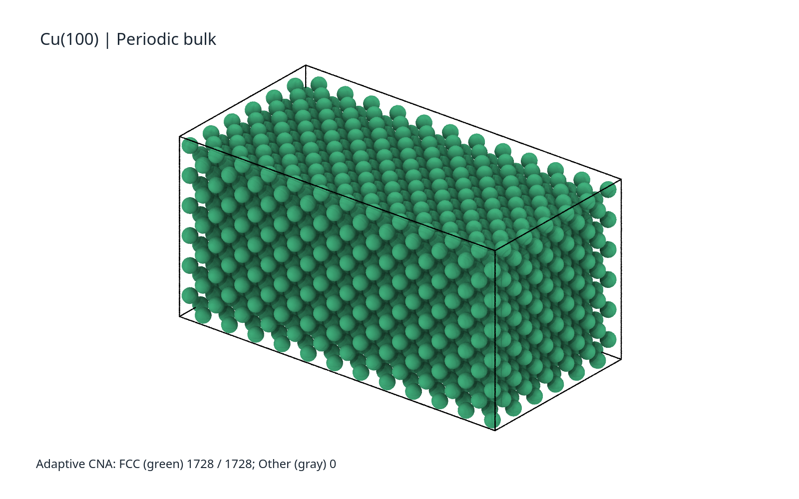
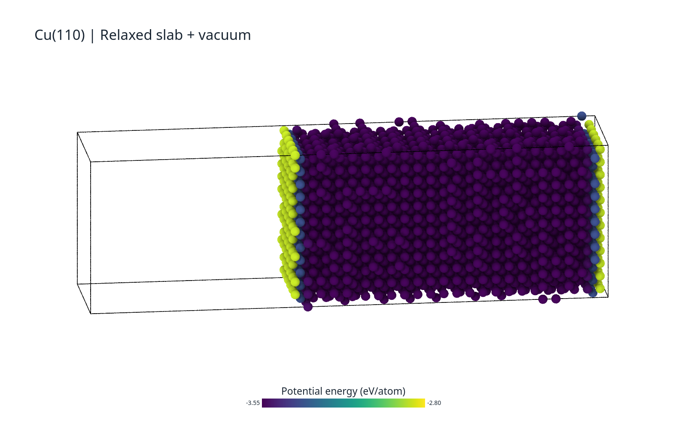
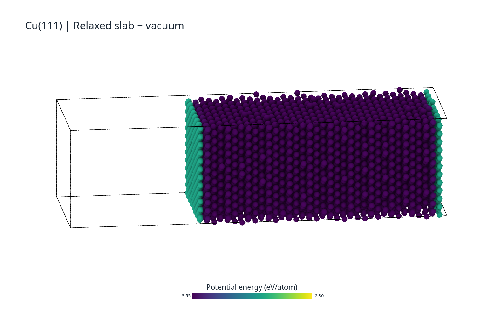

## 周期体相

使用 OVITO 的 Adaptive CNA 检查 Cu(100) 参考模型，1728 个原子全部识别为 FCC。

## 含两个表面的模型

沿 x 方向扩展模拟盒，形成真空间隙。模型仍采用三维周期性边界；两个自由表面位于薄板的 x 方向两端，y、z 方向没有自由表面。CNA 识别出 1584 个 FCC 原子和 144 个 Other 原子。Other 主要对应配位不完整的表面区域，不能据此称其为非晶。

## 表面与内部的势能差异

在 OVITO 中按 `c_pea` 着色。表面原子的势能高于内部原子，反映形成自由表面带来的能量代价。单个表面原子的势能不能直接等同于单位面积表面能；后者应由 slab 与匹配体相的总能量差计算。

## 另外两个晶面

三幅势能图使用相同色标，范围为 −3.55 至 −2.80 eV/atom。晶面取向由建模输入确定，不能单靠 CNA 识别晶面指数。

这些图片使用官方 OVITO 3.17.1 Python 接口与 Tachyon 渲染器生成，数据来自本次正式 LAMMPS 计算。它们是 OVITO 渲染图，不是软件界面截图。
