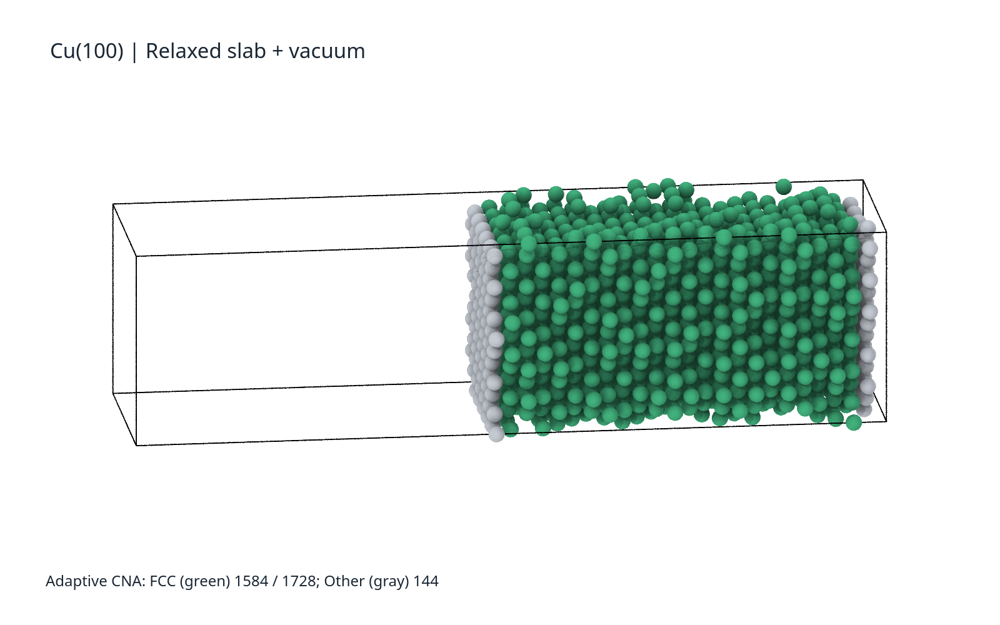
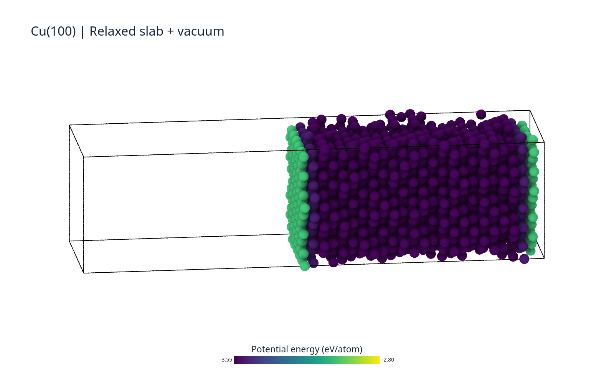
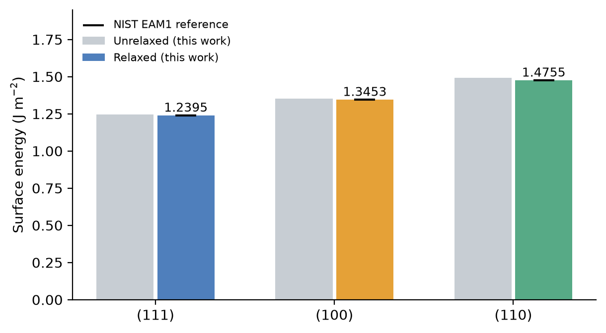
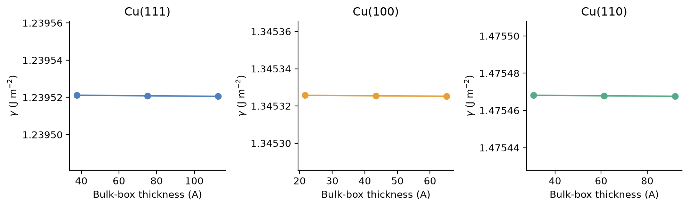
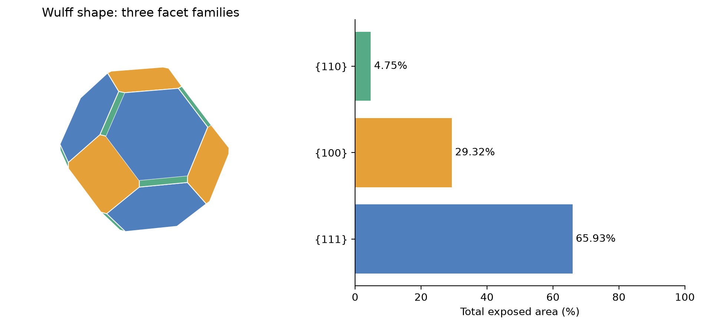
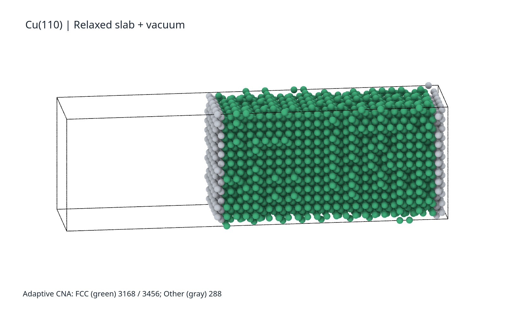
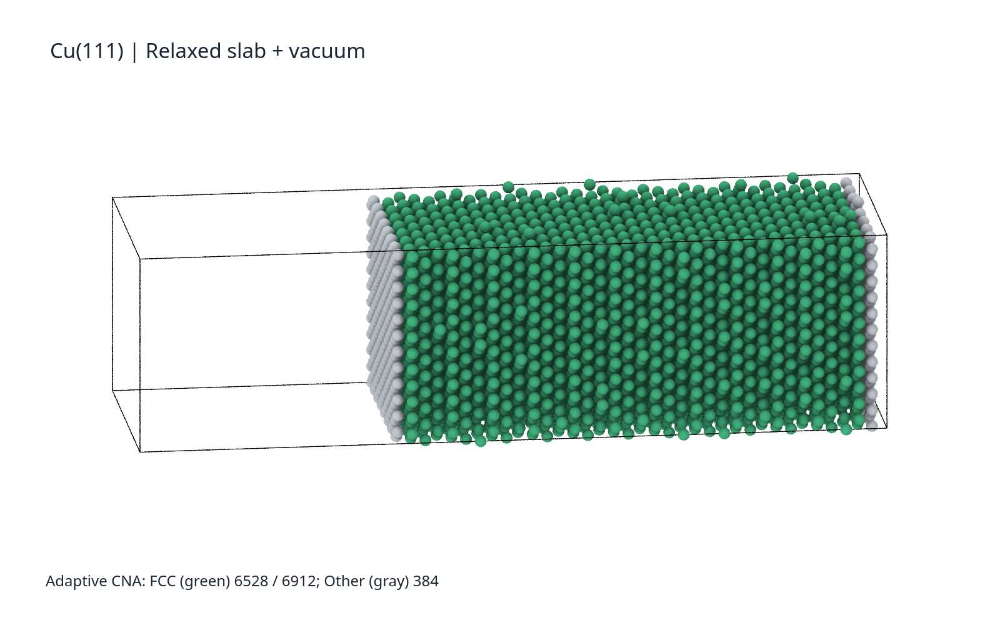

**Cu 低温形貌与表面能计算实验报告**

## 1. 实验题目与目的

本次作业的题目为：

> The morphology of nanocube Cu at low temperature is mostly composed of ? plane, and explain why. What controls its final shape?
>
> Optimal: What’s the theoretical ratios of different plane interceptions?
>
> Tips: compare surface energies for (100), (110), (111) plane of fcc-Cu.

实验围绕“低温下 Cu 倾向于暴露哪些晶面，以及什么决定其最终形状”展开。参考课程提供的 *Exercise 1: Molecular Statics Calculation of surface energy* 实验指导和 `0Surface` 示例脚本，分别计算 FCC Cu 的 (100)、(110)、(111) 表面能，再利用 Wulff 构造分析平衡形貌，并求出选做题中的晶面距离比。

本实验采用 0 K 能量最小化，用弛豫后的表面能近似低温表面自由能。计算内容是分子静力学，没有直接模拟纳米立方体随时间改变形状的过程。

## 2. 实验原理

### 2.1 表面能的计算

晶体内部的原子被周围原子包围，而表面原子的配位不完整。形成自由表面会增加体系能量，单位表面积对应的能量增量称为表面能。

按照课程指导，建立两个模型：模型 A 为没有自由表面的周期性完整晶体，模型 B 在相同原子数的基础上引入真空，形成两个等价的自由表面。分别最小化后，表面能为

$$
\gamma_{hkl}=\frac{E_B-E_A}{2A}.
$$

其中，$E_A$ 和 $E_B$ 为两个模型的总势能，$A$ 为单侧表面积，分母中的 2 来自两个自由表面。两模型应使用相同势函数，保持原子数和面内尺寸一致。

本实验将表面法向设为模拟盒的 x 方向，因此

$$
A=L_yL_z.
$$

LAMMPS 使用 `metal` 单位体系，能量和长度分别为 eV、Å，换算关系为

$$
1\ \mathrm{eV/\AA^2}=16.02176634\ \mathrm{J/m^2}.
$$

### 2.2 表面能与 Wulff 构造

FCC 的不同晶面具有不同的原子排列和配位环境，所以表面能也不同。{111} 是 FCC 的密排面，一般具有较低的表面能；具体数值仍需要用同一个势函数计算比较。这里用 (111) 表示某一个晶面，用 {111} 表示对称等价的一族晶面。

对于体积固定、没有基底和吸附物的颗粒，平衡形貌应使各晶面的总表面自由能最小：

$$
G_{\mathrm{surface}}=\sum_i\gamma_iA_i.
$$

Wulff 构造给出晶面到共同中心的垂直距离 $h_i$ 与其表面能之间的关系：

$$
\frac{h_i}{\gamma_i}=\lambda.
$$

因此，可以根据表面能比确定各晶面的位置，再由这些平面的内包络得到平衡形貌。表面能最低并不意味着只保留这一族晶面，因为形貌需要同时满足固定体积和总能量最低的要求。

## 3. 实验过程

### 3.1 计算设置

势函数采用课程提供的 `CuYM.eam.alloy`，文件头标注为 Mishin 2001 Cu EAM1。计算在思源集群上通过 Slurm 运行，使用 LAMMPS；结构检查和出图使用 OVITO 3.17.1 Python 接口。

| 项目 | 设置 |
|---|---|
| 晶体结构 | FCC Cu |
| 晶格常数 | 3.615 Å |
| 原子间作用势 | 课程提供的 Mishin 2001 Cu EAM1 |
| 势函数截断半径 | 5.50679 Å |
| 边界条件 | x、y、z 三方向周期性 |
| 引入真空的方向 | x 方向，即所研究晶面的法向 |
| 基准真空增量 | 40 Å |
| 三晶面统一比较的最小化方法 | 共轭梯度法（CG） |
| 停止容差 | 能量容差 0，力二范数容差 $10^{-8}$ eV/Å |
| 最小化上限 | 10000 次迭代、100000 次力/能量计算 |

先复现课程提供的 (100)、(111) 案例，再增加 (110) 模型，并在统一设置下比较三个晶面。各模型的取向如下，x 方向均为表面法向。

| 晶面 | x 方向 | y 方向 | z 方向 |
|---|---|---|---|
| (100) | [100] | [010] | [001] |
| (110) | [110] | [−110] | [001] |
| (111) | [111] | [1−10] | [11−2] |

### 3.2 建立周期性参考晶体

首先建立三维周期性 FCC Cu 晶体，固定盒长并对原子位置进行能量最小化，记录参考能量 $E_A$。

图 1：OVITO 中的 Cu(100) 参考模型。Adaptive CNA 将 1728 个原子全部识别为 FCC，说明参考模型具有完整的 FCC 局域结构。图中的盒子边界是周期边界，并不是自由表面。

### 3.3 引入真空并弛豫表面

保持原子坐标和原子数不变，将模拟盒的 x 下界向负方向扩展 40 Å。这样相邻周期镜像之间出现真空间隙，Cu 薄板的 x 方向两端形成两个自由表面。随后再次进行能量最小化，记录 $E_B$。

图 2：OVITO 中含真空的 Cu(100) 模型。内部原子仍主要呈 FCC 结构，两端表面原子被 CNA 归为 Other。统计结果为 1584 个 FCC 原子和 144 个 Other 原子；Other 表示局域配位不符合完整晶体结构，不能直接称为非晶。

三个晶面的基准模型参数如下。不同取向的盒长和原子数可以不同，但每个晶面自己的 A、B 模型必须匹配。

| 晶面 | 原子数 | 参考模型 x 方向盒长 / Å | 单侧表面积 / Ų |
|---|---:|---:|---:|
| (100) | 1728 | 43.3800 | 470.4561 |
| (110) | 3456 | 61.3486 | 665.3254 |
| (111) | 6912 | 75.1364 | 1086.4718 |

### 3.4 检查结构和计算稳定性

在 OVITO 中读取最小化后的构型，检查真空间隙、晶体结构和逐原子势能分布；从 LAMMPS 日志提取高精度总能量与盒长，计算表面能。

另外，为每个晶面设置三种薄板厚度，并将基准模型的真空增量从 40 Å 增至 60 Å、力容差收紧至 $10^{-10}$ eV/Å，检查所得表面能是否稳定。

## 4. 实验结果与分析

### 4.1 表面与内部原子的势能

图 3：使用 OVITO 按逐原子势能着色的 Cu(100) 薄板，单位为 eV/atom。表面区域的原子势能高于内部原子，与形成表面需要付出能量的认识一致。

Cu(100) 模型内部原子势能约为 −3.54 eV，最外层表面原子约为 −3.03 eV。这里的颜色展示局部能量差异；计算单位面积表面能时，仍应使用整个模型相对于体相的总能量增量。

### 4.2 三个晶面的表面能

从基准模型日志得到以下结果。表中的 A、B 为同一晶面下原子数相同的两个模型。

| 晶面 | $E_A$ / eV | $E_B$ / eV | 弛豫表面能 / (J/m²) |
|---|---:|---:|---:|
| (100) | −6117.497241 | −6038.490150 | 1.3453 |
| (110) | −12234.994481 | −12112.452906 | 1.4755 |
| (111) | −24469.988962 | −24301.879599 | 1.2395 |

以 (100) 为例，两个表面的能量增量约为 79.007090 eV，单侧面积为 470.4561 Ų，因此

$$
\gamma_{100}=\frac{79.007090}{2\times470.4561}\times16.02176634
\approx1.3453\ \mathrm{J/m^2}.
$$

图 4：三个晶面弛豫前后的表面能，以及 NIST 提供的 Mishin 2001 Cu EAM1 参考计算值。这里的 NIST 数值是势函数计算结果，不是实验测量值。

三个晶面在表面弛豫后能量均有所降低，弛豫表面能满足

$$
\gamma_{111}<\gamma_{100}<\gamma_{110}.
$$

NIST 对同一势模型另一转换实现给出的 (111)、(100)、(110) 参考值分别为 1.23946、1.34525、1.47539 J/m²，本次结果与其接近。该对照说明本次计算流程合理，但不能由此认为势函数与真实 Cu 的误差也同样小。

### 4.3 收敛检查

图 5：三种薄板厚度对应的表面能。横轴采用引入真空前的法向盒长表示厚度参数；纵轴放大后可看到数值变化仍很小。

基准厚度增大到 1.5 倍后，三个晶面的表面能相对变化均小于 0.00003%；真空增量从 40 Å 增加到 60 Å 后，报告精度下的数值保持不变。收紧请求的力容差也没有改变表面能排序。

需要说明，(111) 的 CG 最小化因 `linesearch alpha is zero` 停止，最终最大力分量约为 $6.37\times10^{-7}$ eV/Å，未达到设定的严格力二范数阈值。结合厚度检查和参考结果，本文采用其表面能进行比较，但不将该情况写成严格满足力容差。此外，晶格常数沿用课程值且盒长固定，体相仍有约 −8.60 MPa 的小残余压力。

## 5. 作业问题回答

### 5.1 低温下主要由什么晶面组成？为什么？

根据本次表面能比较，**对于清洁、自由、达到平衡的 Cu 颗粒，在所考虑的三族低指数晶面中，主要暴露的是 {111} 面。**

原因是 {111} 为 FCC 的密排面，表面形成带来的能量代价较小。本次计算得到的 (111) 表面能为 1.2395 J/m²，低于 (100) 和 (110)。将这三族晶面一起用于 Wulff 构造，得到下面的形貌。

图 6：使用本次表面能构造的 Wulff 形貌。蓝色为 {111}，橙色为 {100}，绿色为 {110}。该图由几何构造得到，不是纳米颗粒 MD 演化的最终帧。

| 晶面族 | 总暴露面积占比 |
|---|---:|
| {111} | 65.93% |
| {100} | 29.32% |
| {110} | 4.75% |

可以看到，{111} 面占据主要面积，但仍有 {100} 和少量 {110} 面。这里的面积比例只针对三族晶面构造；加入其他取向后，形貌和比例还可能调整。

题目使用了 “nanocube” 一词，需要区分初始形状与平衡形状：如果严格指沿 ⟨100⟩ 排列、保持立方外形的 FCC 单晶，那么六个外表面属于 {100}。本实验根据题目“比较三种表面能”的提示，讨论的是初始立方颗粒所趋向的平衡形貌，不能把一个保持立方外形的颗粒直接解释为由 {111} 面围成。

### 5.2 什么决定最终形状？

**平衡形状主要由表面自由能的各向异性，以及颗粒体积约束决定。** 颗粒通过调整不同晶面的相对位置和面积，使总表面自由能最低。Wulff 关系说明，决定形状的是各晶面的表面能比，而不只是某一个晶面的绝对数值。

实际得到的形状还受原子扩散和生长动力学影响。低温下原子迁移较慢，初始立方体可能长时间保持亚稳形状；吸附物、基底、缺陷以及颗粒尺寸也可能改变形貌。因此，单次能量最小化并不保证颗粒能够跨过重排势垒、达到全局平衡形状。

### 5.3 选做：不同晶面到中心的距离比

Wulff 理论给出各晶面到颗粒中心的垂直距离与表面能之间的关系：

$$
\frac{h_{100}}{\gamma_{100}}
=\frac{h_{110}}{\gamma_{110}}
=\frac{h_{111}}{\gamma_{111}}.
$$

代入本次计算得到的表面能，三个晶面的距离比为

$$
h_{100}:h_{110}:h_{111}
=1.345325:1.475468:1.239521.
$$

以 (111) 晶面到中心的距离为 1，得到

$$
h_{100}:h_{110}:h_{111}=1.08536:1.19035:1.
$$

在构造形貌时，先选定颗粒中心，再沿 [100]、[110]、[111] 及其对称等价方向，按上述比例放置对应晶面。这些平面共同围成图 6 所示的 Wulff 形貌，其中 {111} 面占据主要面积。

## 6. 实验总结

本实验参考课程提供的表面能计算方法，完成了 FCC Cu 的 (100)、(110)、(111) 三个晶面的 0 K 弛豫计算，并使用 OVITO 检查结构和表面原子能量分布。所得表面能分别为 1.3453、1.4755、1.2395 J/m²，说明 {111} 面的形成代价最低。

在本实验的三晶面族 Wulff 构造中，{111} 面占约 65.93%，为平衡形貌的主要暴露面；各晶面的中心垂距比满足 Wulff 关系。实际低温纳米立方体还可能受动力学限制保留 {100} 外表面，因此判断形貌时需要同时考虑平衡表面能与原子重排能否发生。

## 参考资料

1. 课程提供的 *Exercise 1: Molecular Statics Calculation of surface energy (MmmsFall)* 实验指导，以及 [课程示例代码仓库](https://gitee.com/sjtu-liugs/mmmsfall) 中的 `0Surface` 文件。
2. Mishin, Y. et al. (2001). Structural stability and lattice defects in copper: Ab initio, tight-binding, and embedded-atom calculations. *Physical Review B*, 63, 224106. [原文链接](https://doi.org/10.1103/PhysRevB.63.224106)。
3. [NIST：Mishin 2001 Cu EAM1 势及参考计算结果](https://www.ctcms.nist.gov/potentials/entry/2001--Mishin-Y-Mehl-M-J-Papaconstantopoulos-D-A-et-al--Cu-1/2001--Mishin-Y--Cu-1--LAMMPS--ipr1.html)。
4. [OVITO：Common neighbor analysis](https://www.ovito.org/manual/reference/pipelines/modifiers/common_neighbor_analysis.html)；[LAMMPS：minimize](https://docs.lammps.org/minimize.html)。
5. Tran, R. et al. (2016). Surface energies of elemental crystals. *Scientific Data*, 3, 160080. [原文链接](https://doi.org/10.1038/sdata.2016.80)。

## 附录：其他晶面的 OVITO 图

### A.1 Cu(110) 的结构检查

图 A1：Cu(110) 薄板的 Adaptive CNA 结果。绿色区域为 FCC，灰色区域位于两端自由表面。3456 个原子中，3168 个被识别为 FCC，288 个归为 Other，说明弛豫后的内部仍保持 FCC 结构。

### A.2 Cu(110) 的原子势能分布

图 A2：Cu(110) 薄板按逐原子势能着色的结果。两端表面原子的势能明显高于内部，最外层表面原子的势能约为 −2.87 eV/atom。

### A.3 Cu(111) 的结构检查

图 A3：Cu(111) 薄板的 Adaptive CNA 结果。6912 个原子中，6528 个被识别为 FCC，384 个归为 Other。与 Cu(100)、Cu(110) 模型一样，结构差异主要集中在自由表面附近。

### A.4 Cu(111) 的原子势能分布

图 A4：Cu(111) 薄板按逐原子势能着色的结果。最外层表面原子的势能约为 −3.11 eV/atom，内部原子约为 −3.54 eV/atom。各晶面的势能图均采用 −3.55 至 −2.80 eV/atom 的统一色标。
