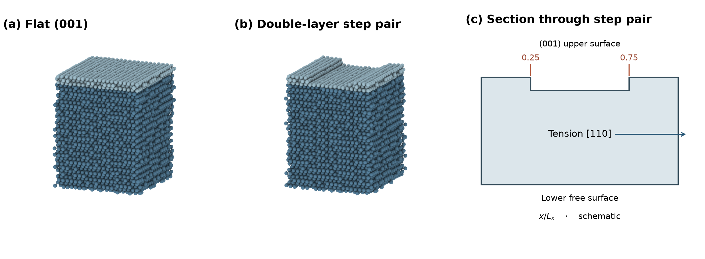
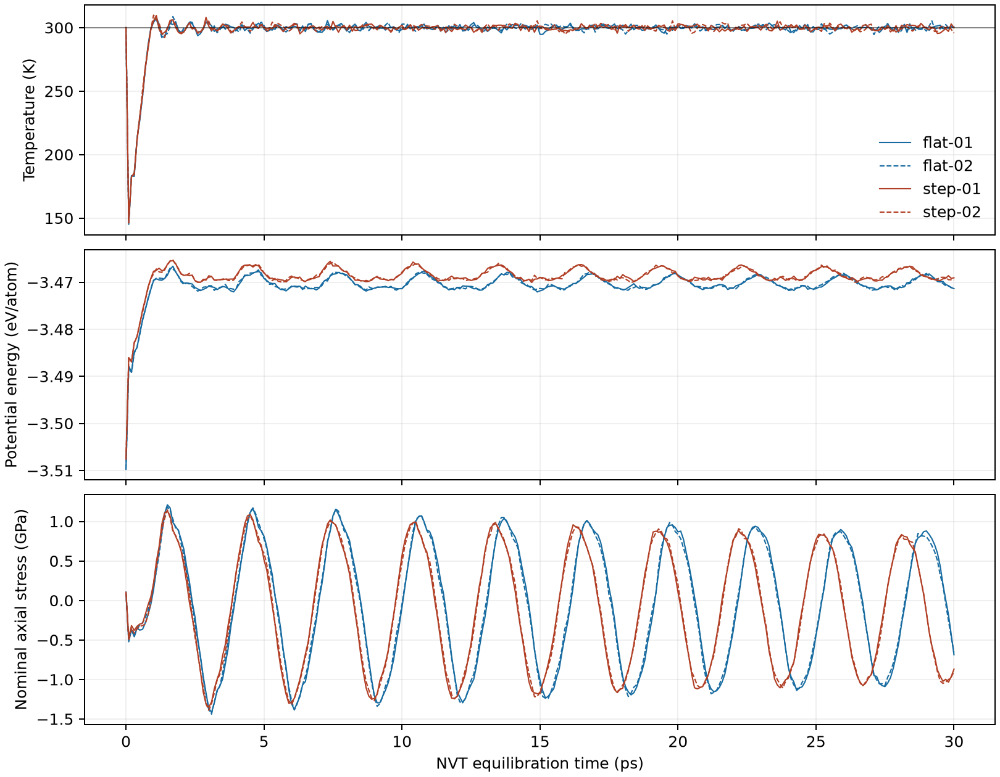
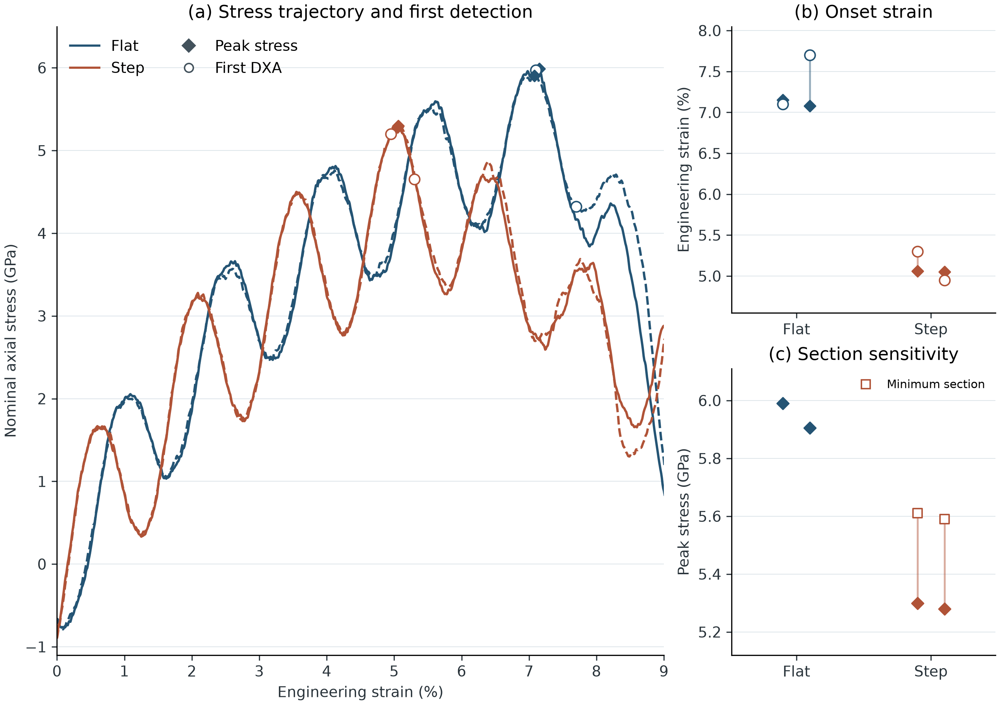
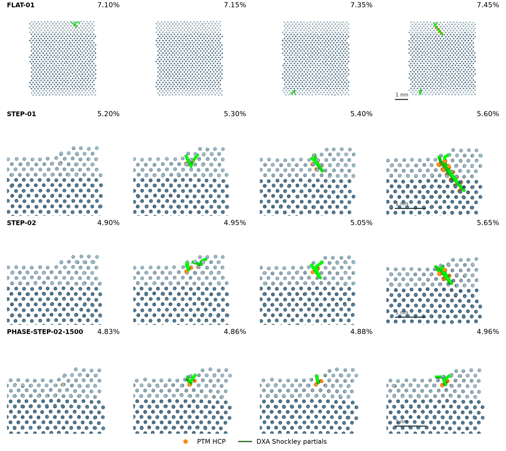
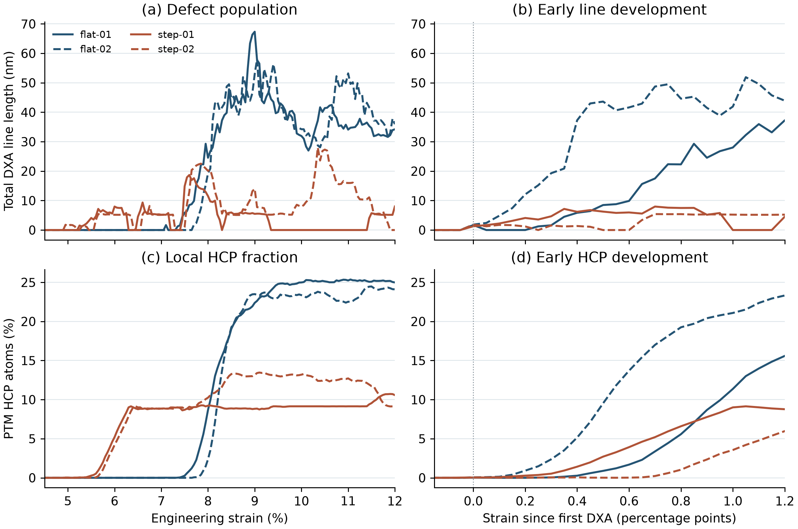
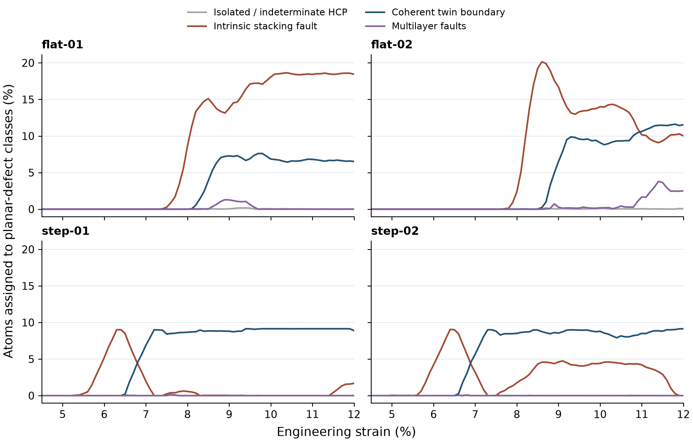
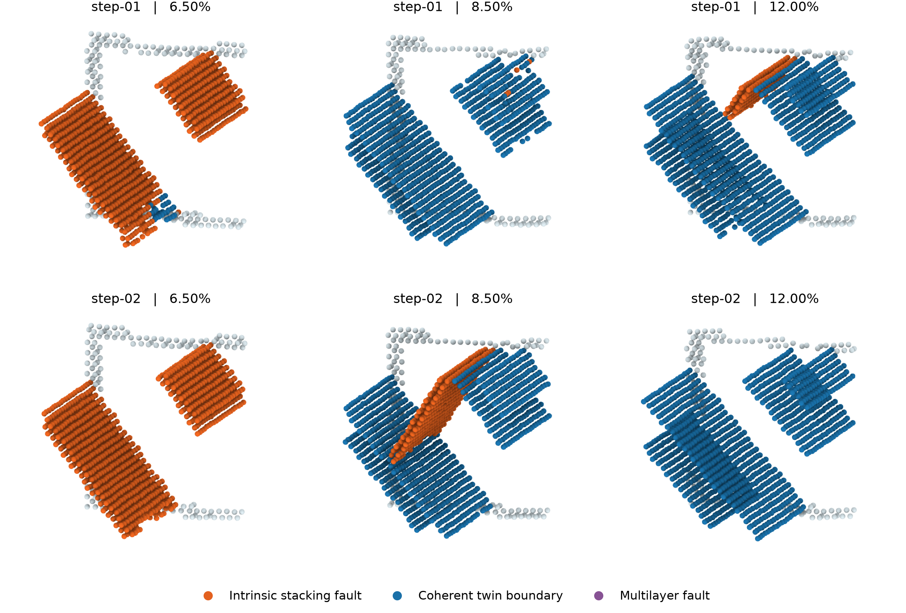
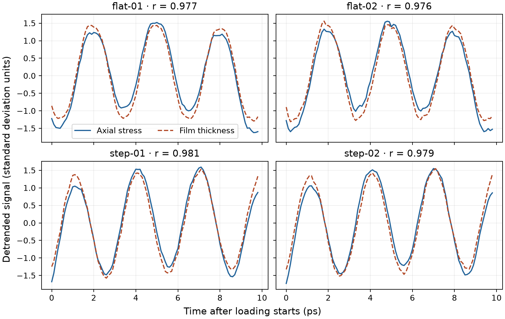
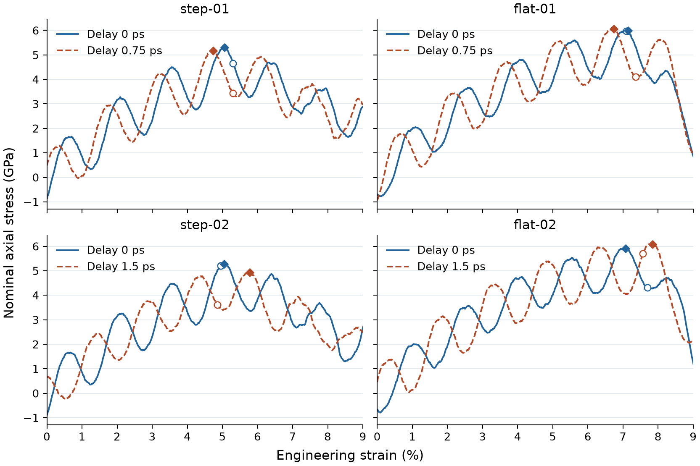

# 表面台阶对 FCC 铜薄膜初始塑性的影响

**作者** 高笳皓  
**学号** 126050910050

## 摘要

用分子动力学模拟比较了 300 K 下平整铜薄膜和带双原子层台阶的铜薄膜。两种薄膜的表面均为 (001)，沿 [110] 方向以 $5\times10^9\ \mathrm{s^{-1}}$ 的工程应变率拉伸，面内横向尺寸固定。每种表面分别用两组初始速度进行模拟。带台阶的薄膜在 4.95%–5.30% 应变时首次检出位错，平整薄膜在 7.10%–7.70% 时首次检出。带台阶薄膜的早期部分位错均出现在同一侧台阶边附近，两次模拟的平均峰值名义应力比平整薄膜低 0.66 GPa。延迟开始拉伸后，台阶组仍在较低应变时检出位错。OVITO 的构型分析还显示，两个台阶样品在 6.50% 应变时以本征层错为主，到 12% 时以相干孪晶界为主。

**关键词** 铜薄膜、表面台阶、位错形核、分子动力学

## 1. 引言

在内部缺陷较少的金属薄膜中，位错可以从自由表面产生[1]。表面台阶附近的原子排列与平整表面不同，位错可能优先从那里出现。同时，台阶处的薄膜更薄，计算应力时选取的截面积也会影响比较结果。本文结合原子构型和应力–应变曲线，考察这两个方面。

第 7 讲给出了铝螺位错和钨刃位错的例子，通过对照应力曲线和 OVITO 构型观察位错运动[2,3]。本文沿用这个方法，从没有预置位错的铜薄膜开始拉伸，比较有无台阶时，位错最早在哪里出现、当时的应变是多少，以及两组的应力峰值相差多少。随后更换截面积的取法，并延迟开始拉伸，检查比较结果是否改变。

## 2. 原理与计算方法

### 2.1 原子间相互作用与时间积分

采用 Mishin Cu EAM1 势描述单组元 FCC 铜。按照课程第 3 讲的嵌入原子模型[4]，总势能由两体项和局部环境相关的嵌入项组成

$$
U=\sum_i F(\rho_i)+\frac{1}{2}\sum_i\sum_{j\ne i}\phi(r_{ij}),
\qquad
\rho_i=\sum_{j\ne i} f(r_{ij}).
$$

其中 $r_{ij}$ 是原子间距，$f(r_{ij})$ 是原子 $j$ 对位置 $i$ 的电子密度贡献，$\phi$ 为两体势，$F$ 为嵌入能。台阶附近的配位改变会通过 $\rho_i$ 改变嵌入能。原子间力为 $\mathbf F_i=-\nabla_i U$，确定热运动和外载下的结构演化。该势的参数化考虑了铜的结构稳定性和晶格缺陷性质[5]。

第 2 讲中的速度 Verlet 算法用两个半步更新速度，并在新的坐标上重算作用力[6]。忽略恒温算符时，积分的力学部分可写为

$$
\begin{aligned}
\mathbf v_i^{n+1/2}&=\mathbf v_i^n+\tfrac{\Delta t}{2m_i}\mathbf F_i^n,\\
\mathbf r_i^{n+1}&=\mathbf r_i^n+\Delta t\,\mathbf v_i^{n+1/2},\\
\mathbf v_i^{n+1}&=\mathbf v_i^{n+1/2}+\tfrac{\Delta t}{2m_i}\mathbf F_i^{n+1}.
\end{aligned}
$$

### 2.2 周期边界、能量最小化与温控

以 $x\parallel[110]$、$y\parallel[\bar{1}10]$、$z\parallel[001]$ 建立右手坐标系。沿 $x,y$ 采用周期边界，$z$ 方向非周期，两侧留有真空。按照第 4 讲的周期边界概念[7]，沿周期方向的近邻位移可用最小镜像表示为 $\Delta r_\alpha-L_\alpha\operatorname{round}(\Delta r_\alpha/L_\alpha)$。因此台阶模型代表面内重复的沟槽几何。台阶间距和周期重复距离均由建模尺寸决定。

初始几何在固定盒长下用 FIRE 弛豫，对应第 5 讲所述的势能局部最小化[8]。随后按 300 K 高斯速度分布初始化并移除质心平动。温度由动能估计

$$
K=\sum_i\tfrac12 m_i|\mathbf v_i|^2,\qquad T=\frac{2K}{gk_\mathrm B},
$$

其中 $g$ 是温度计算的自由度数，此处按去除质心平动的 $3N-3$ 计。第 6 讲的 Nosé–Hoover 恒温方法[9]通过附加变量调节动能。用一阶热浴变量可写出反馈机制

$$
\dot{\mathbf p}_i=\mathbf F_i-\zeta\mathbf p_i,\qquad
Q\dot\zeta=2K-gk_\mathrm B T_0 .
$$

其中 $\zeta$ 是热浴摩擦变量，$Q$ 是热浴惯性参数。实际积分使用 LAMMPS 的 Nosé–Hoover 实现[10]。平衡段在固定盒长下恒温 30 ps。随后恒温并连续改变 $L_x$，加载段是受驱动的过程。

### 2.3 加载、维里应力与截面归一化

LAMMPS 的压力张量包含动能项和相互作用维里项[11]。本体系的体积平均压力可写为

$$
P_{\alpha\beta}=\frac{1}{V_{\rm box}}
\left(\sum_i m_i v_{i\alpha}v_{i\beta}
      +W_{\alpha\beta}\right),\qquad
W_{\alpha\beta}=\sum_c W_{\alpha\beta}^{(c)}.
$$

其中 $c$ 枚举势函数的相互作用贡献，LAMMPS 按周期镜像与多体势定义计算维里。在两体势的特例中，维里可写为 $W_{\alpha\beta}=\tfrac{1}{2}\sum_{i\ne j}r_{ij,\alpha}F_{ij,\beta}$。由于盒体积包含真空，先从 $-P_{xx}V_{\rm box}/L_x$ 求轴力，再以材料参考面积 $A_0$ 归一化。工程应变与名义应力为

$$
\varepsilon_x=\frac{L_x-L_{x0}}{L_{x0}},\qquad
A_0=L_{y0}h_0,\qquad
\sigma_{x,\mathrm{nom}}=
-\frac{P_{xx}V_{\rm box}}{L_xA_0}\times 10^{-4}\ \mathrm{GPa},
$$

最后一式中的 $P_{xx}$ 以 bar 输入，拉伸取正。$L_y$ 固定，加载过程中横向应力可为非零。台阶组还用最薄处的厚度 $17a$ 计算截面积，并据此重算应力。

### 2.4 位错、层错与初始塑性

FCC 晶体的完整位错和 Shockley 部分位错的柏氏矢量分别属于 $a/2\langle110\rangle$ 和 $a/6\langle112\rangle$，大小分别为 $a/\sqrt2$ 和 $a/\sqrt6$。例如，一个 $(111)$ 面上的完整位错可以分解为两个部分位错[2]

$$
\frac{a}{2}[1\bar10]=\frac{a}{6}[2\bar1\bar1]+\frac{a}{6}[1\bar21].
$$

两个 Shockley 部分位错之间可形成层错。首先发射的部分位错向晶内运动时，可在其扫过的滑移面上留下局部 HCP 堆垛。本文用 OVITO 的多面体模板匹配（PTM）[12]找出这类局部配位，再用位错提取算法（DXA）识别位错线与柏氏矢量[13]。观察到个别 HCP 型原子时，再查看它们是否聚在一起，附近是否有位错线，以及之后是否扩展。

第 7 讲给出的 Peach–Koehler 力[2]决定已形成位错线在外部及内部应力下受到的驱动力。以 $\boldsymbol\xi$ 为位错线方向、$\mathbf b=b\mathbf s$ 为柏氏矢量、$\mathbf n$ 为滑移面法向，

$$
\mathbf f=(\boldsymbol\sigma\mathbf b)\times\boldsymbol\xi,\qquad
\tau=\mathbf s\cdot\boldsymbol\sigma\,\mathbf n,\qquad |f_{\rm glide}|=b|\tau|.
$$

以 $(111)[11\bar2]$ 为例，若只有 [110] 方向的轴向应力，Schmid 因子为 $2/\sqrt{18}\approx0.471$。本模型固定了面内横向尺寸，计算分解剪应力时还要考虑其他应力分量。

设一个表面部分位错半环的半径为 $R$，在有效线能 $\Gamma$ 恒定、平面滑移和局部 $\tau$ 均匀的近似下，可用线能、层错能与外力做功的竞争描述其能量变化[1]

$$
\Delta G(R)\simeq \pi R\Gamma +
\frac{\pi R^2}{2}\gamma_{\rm sf}
-\frac{\pi R^2}{2}\tau b.
$$

三项依次表示位错线能、层错能和外应力做功。若 $\tau b>\gamma_{\rm sf}$，则临界半径为 $R_\ast=\Gamma/(\tau b-\gamma_{\rm sf})$。在这个简化模型中，半环超过该半径后，继续扩展可以降低能量。实际台阶附近的应力与结构更复杂，本文只用这个模型解释部分位错出现后为什么可能向晶内扩展。

### 2.5 模型参数与轨迹分析

*表 1　原子模型、弛豫过程与加载参数。*

| 项目 | 设定 |
| --- | --- |
| 仿真程序与相互作用 | LAMMPS 29 Aug 2024 Update 1，Mishin Cu EAM1 |
| 晶体取向 | $x\parallel[110]$，$y\parallel[\bar110]$，$z\parallel[001]$ |
| 初始尺寸 | $a=3.615$ Å，$L_{x0}=L_{y0}=20a/\sqrt2$，名义厚度 $h_0=18a$ |
| 表面构型 | 平整组 14,400 原子。台阶组 14,000 原子，移除上表面半个周期范围内的两层原子 |
| 平衡条件 | FIRE 弛豫，固定盒长，300 K，30 ps，积分步长 1 fs，温控阻尼时间 0.1 ps |
| 平衡后直接拉伸 | 300 K，$5\times10^9\ \mathrm s^{-1}$，[110] 拉伸，横向盒长固定，两种形貌各 2 个速度种子 |
| 输出 | 直接拉伸至 12%，热力学间隔 0.02 ps，构型间隔 0.10 ps |
| 延迟加载 | 名义加载参数相同，等待 0.75 或 1.50 ps，拉至 9%，构型间隔 0.02 ps |

计算按如下顺序进行。

1. **构造两种表面。** 从具有相同取向和晶格参数的 FCC 晶格构造平整薄膜，在台阶组上表面移除两层原子。两条台阶边沿 $y$，初始位置为 $x/L_x=0.25$ 和 0.75。两自由面外各留约 25 Å 真空。
2. **弛豫初态。** 固定盒长，以 FIRE 最小化总势能。相对能量容差为 $10^{-10}$，力范数容差为 $10^{-6}$ eV/Å，迭代和能量/力评估上限分别为 3,000 和 12,000[14]。两种几何均因能量容差停止。平整和台阶构型的最终力二范数分别为 $2.85\times10^{-3}$ 和 $1.87\times10^{-3}$ eV/Å。
3. **恒温平衡与拉伸。** 每种表面使用两组独立生成的初始速度，在 300 K 平衡 30 ps。随后沿 $x$ 以固定工程应变率改变盒长，并仿射重映射原子坐标[15]。两组的名义截面、横向约束和温控参数相同。延迟加载沿用各样品原来的平衡构型和速度，在 300 K 下再等 0.75 或 1.50 ps，然后开始拉伸。
4. **将原子构型与应力对应起来。** 按 LAMMPS 步数匹配热力学记录和原子帧。用 OVITO 3.17.1 中的 CNA 检查初始结构，用 PTM 和 DXA 识别 HCP 型环境和部分位错。采用正交相机与 Tachyon 渲染器绘制模型与缺陷序列。对面状缺陷，在 PTM 输出晶格取向和原子间距后使用 Identify FCC Planar Faults，依据相邻 $\{111\}$ 层的 HCP 排列区分本征层错、相干孪晶界和多层缺陷[16]。平面缺陷演化每 0.20 ps 采一帧。

### 2.6 怎样确定首次出现的位错

从第一帧开始逐帧检查。DXA 第一次识别到 $a/6\langle112\rangle$ 部分位错的应变记为首次检出应变。前一帧和首次检出帧给出应变的上下界。若两个相邻帧的位错线中心相距不超过 0.8 nm，就把它们视为出现在同一处。距离按面内周期边界计算。连续三帧都能在同一处找到位错时，记下这三帧中第一帧的应变和位置。

以原子 $z$ 坐标的第 0.5 和 99.5 百分位估计上下表面的高度。若位错线有一点进入距上表面或下表面 0.6 nm 的范围，就归入相应的表面附近。对带台阶的薄膜，如果上表面附近的同一个点与任一台阶切平面的横向距离不超过 0.5 nm，则归入该台阶附近。台阶切平面的位置随盒长按比例调整。

*图 1　(a,b) 平衡后的平整与双层台阶铜薄膜。浅色突出上部原子层。(c) 沿拉伸轴的截面示意，标出两条台阶边、上下自由面和加载方向。示意中台阶高度经过放大。*

## 3. 结果

### 3.1 平衡构型

四个样品平衡 30 ps 后，温度都接近 300 K，DXA 没有检出位错，PTM 也没有找到 HCP 型原子。用第 7 讲实验中的共近邻分析（CNA）也没有找到 HCP 型原子，平整和台阶模型的 FCC 原子占比分别约 94.4% 和 94.0%。未归入 FCC 的部分主要来自配位不足的自由表面与台阶边。把 $x$ 方向等分为 20 箱，以各箱 $z$ 坐标的第 97.5 百分位作为表层高度，再比较高、低平台的中位高度，两条台阶样品的高度差为 3.53 和 3.43 Å，平整样品的高度差绝对值小于 0.03 Å。平衡阶段的轴向应力上下波动。平衡结束时，四个样品的轴向名义应力都为负，约为 −0.90 至 −0.66 GPa。

*图 2　各样品的温度、每原子势能与轴向名义应力随平衡时间的变化。*

### 3.2 应力与早期缺陷

表 2 列出第一次看到位错的应变范围，以及连续三帧都能找到位错的位置。平衡后直接拉伸每 0.10 ps 保存一帧，延迟加载每 0.02 ps 保存一帧，因此三帧分别跨越 0.20 ps 和 0.04 ps。应力峰值从每 0.02 ps 保存的热力学记录中读取。

*表 2　首次检出位错的位置、应变和应力。台阶边以 $x/L_x$ 表示。*

| 样品 | 等待（ps） | 首次检出应变范围（%） | 首次位置 | 检出帧应力（GPa） | 连续三帧的起始应变和位置 | 峰值应力（GPa） |
| --- | ---: | ---: | --- | ---: | --- | ---: |
| flat-01 | 0.00 | (7.05, 7.10] | 上自由面 | 5.972 | 7.35% · 下自由面 | 5.991 |
| flat-02 | 0.00 | (7.65, 7.70] | 下自由面 | 4.321 | 7.70% · 下自由面 | 5.905 |
| step-01 | 0.00 | (5.25, 5.30] | 台阶边 0.75 | 4.655 | 5.30% · 台阶边 0.75 | 5.299 |
| step-02 | 0.00 | (4.90, 4.95] | 台阶边 0.75 | 5.201 | 4.95% · 台阶边 0.75 | 5.279 |
| flat-01 | 0.75 | (7.35, 7.36] | 上自由面 | 4.111 | 7.41% · 上自由面 | 6.055 |
| step-01 | 0.75 | (5.29, 5.30] | 台阶边 0.75 | 3.437 | 5.30% · 台阶边 0.75 | 5.163 |
| flat-02 | 1.50 | (7.56, 7.57] | 膜内 | 5.700 | 7.64% · 上自由面 | 6.083 |
| step-02 | 1.50 | (4.85, 4.86] | 台阶边 0.75 | 3.613 | 4.86% · 台阶边 0.75 | 4.934 |

在平衡后直接拉伸的四次模拟中，平整组和台阶组的平均峰值应力分别为 5.948 和 5.289 GPa，相差 0.659 GPa，约为平整组的 11.1%。若用台阶下方最薄处的截面积重算，台阶组的峰值升至 5.590–5.611 GPa，仍低于两个平整样品。

*图 3　(a) 0–9% 应变的轴向应力–应变曲线，实线与虚线表示不同的初始速度。(b) 同一试样的峰值应力对应的应变（实心菱形）与首次检出应变（空心圆）。(c) 按初始名义截面计算的峰值与按最小几何截面换算后的峰值（空心方形）。*

### 3.3 早期位错的空间位置与扩展

图 4 给出了最早几帧的位错位置。台阶样品 step-01 在 5.20% 应变时先在台阶边附近出现 HCP 型原子，5.30% 时检出长 1.28 nm 的部分位错，5.40% 时线长增至 2.22 nm，并向薄膜内部伸展。另一个台阶样品 step-02 在 4.95% 时检出两条短线，其中一条贴近台阶边。随后有几帧没有检出位错，到 5.60% 后陆续出现多条位错线。两个样品最早检出位错的台阶边都是 $x/L_x=0.75$。

平整样品 flat-01 在 7.10% 时于上表面检出一条约 1.68 nm 的位错线，下一帧便未检出。到 7.35% 时，下表面出现了连续几帧都能找到的位错。flat-02 在下表面检出位错后，线长在 7.70%–7.85% 间从 1.85 nm 增至 3.82 nm。两种表面上最早检出的线段均符合 Shockley 部分位错的柏氏矢量。以 step-01 为例，从 5.30% 到 5.60%，位错线最深处的 $z$ 坐标由 5.66 nm 降至 4.85 nm。两帧相差 0.60 ps，折合沿膜厚方向约 $1.35\times10^3$ m/s。这里只估计了位错线向晶内伸展的速度分量，实际滑移速度还需沿同一滑移面追踪。

*图 4　OVITO 中的部分位错及其附近的原子。第一行为平整薄膜全厚度视野，第二、三行为两条独立台阶轨迹，第四行为 step-02 的延迟加载。后三行放大显示上表面台阶边。蓝灰色为沿 $y$ 的 3 Å 厚背景晶格切片，橙色为视野内 PTM 标出的 HCP 原子，绿色为 DXA 提取的 Shockley 部分位错线。投影中两处缺陷的 $y$ 坐标可不同。各行最右图含尺度条。*

### 3.4 位错、层错和孪晶界的变化

在 6.50% 应变时，平整组还未检出位错，台阶组已有 8.77%–9.01% 的原子被 PTM 识别为 HCP 型。到 8.50%，平整组的 HCP 型原子比例达到 19.06%–19.25%，高于台阶组的 8.88%–13.27%。图 5 右列以每条曲线首次检出位错的应变为零点，便于比较位错出现后缺陷增加的快慢。用 CNA 复查 step-01 时，6.50% 应变下得到 1,198 个 HCP 型原子，与 PTM 的 1,228 个较接近。5.30% 时两种方法分别给出 2 个和 6 个，说明缺陷很小时识别结果更依赖所用方法。

*图 5　DXA 总线长及 PTM HCP 原子比例。(a,c) 横轴为工程应变。(b,d) 横轴为首次检出位错后的应变增量。*

到 12% 应变时，平整组的位错总线长为 34.21–35.94 nm，台阶组为 0–8.00 nm。即使位错线已经很少，台阶组仍有 9.14%–10.58% 的原子被识别为 HCP 型。图 6 和图 7 显示这些原子主要分布在哪里。两个台阶样品在 6.50% 应变时有 8.50%–9.01% 的原子被归为本征层错，相干孪晶界不足 0.21%。到 12% 时，相干孪晶界的原子比例分别为 8.89% 和 9.14%，本征层错降至 1.68% 和 0。平整组在 8.50% 时仍以本征层错为主，到 12% 时层错和孪晶界共存。这些比例只统计被标记为缺陷的原子，孪晶内部仍呈 FCC 排列的原子没有计入。

*图 6　OVITO 平面缺陷分类。各曲线以对应类别的原子数除以该样品总原子数归一化。相邻三层及以上的多层缺陷可能包含叠置的本征层错或孪晶界。*

*图 7　两条台阶轨迹在 6.50%、8.50% 和 12.00% 应变下的平面缺陷。浅灰原子勾勒表面和截面的局部轮廓。橙色和蓝色分别标记本征层错及相干孪晶界。各视图具有相同取向和比例。*

## 4. 讨论

### 4.1 应力振荡与开始拉伸的时刻

在平衡阶段的 15–30 ps 内，轴向应力的主要振荡周期约为 3 ps。拉伸开始后，到 4.90% 应变为止，四个样品都还没有检出位错。用原子 $z$ 坐标第 99 和第 1 百分位之差估计膜厚，去掉随时间的线性变化后，膜厚与轴向应力的相关系数为 0.976–0.981（图 8）。如果把这段振荡看成弹性波在两自由面之间的一次往返，$c_z\simeq2h_0/T$，取 $h_0=6.507$ nm 和 $T\simeq3$ ps 得到约 4.3 km/s。还需要改变膜厚，检查振荡周期是否也按比例改变，才能进一步判断振荡的来源。

*图 8　拉伸初期厚度变化与轴向应力。两条曲线分别减去线性趋势，再除以各自的标准差，面板标出各轨迹的相关系数。*

为检查振荡是否左右了峰值的比较，对四条曲线分别做了约 0.5、1 和 2 ps 的移动平均。三种窗口下，台阶组的峰值都较低。以 1 ps 为例，台阶组为 5.085–5.101 GPa，平整组为 5.792–5.852 GPa。另从每个样品原来的平衡状态出发，再等 0.75 或 1.50 ps 后开始拉伸。延迟加载沿用了原来的样品，每种表面仍只有两组独立的初始速度。

等待 1.50 ps 后，step-02 开始拉伸时的轴向应力由 −0.900 GPa 变为 +0.645 GPa，首次位错仍出现在同一侧台阶边。在平整样品 flat-02 直接拉伸时，最早能连续三帧找到的位错在下表面。延迟拉伸后，这样的位错先出现在上表面。等待 0.75 ps 后，step-01 也在原来那一侧台阶边检出部分位错。

延迟后，台阶样品仍比同编号的平整样品更早检出位错，峰值应力也更低（表 2 和图 9）。01 组的峰值差由 0.691 GPa 变为 0.892 GPa，02 组由 0.626 GPa 变为 1.149 GPa。0.75 ps 和 1.50 ps 用在不同样品上，因此这些结果只能说明改变加载起点后，两组的峰值差会变。要比较两个等待时长的影响，可以让同一样品分别等待 0.75 和 1.50 ps 再拉伸。

*图 9　直接拉伸和延迟拉伸的名义应力。菱形表示全轨迹峰值，空心圆表示首次 DXA 检出。各曲线展示到共同的 9% 应变。*

为了检查保存帧的间隔是否影响结论，从每条高频轨迹里每隔五帧取一帧，并分别用前五帧作为取样起点，得到五组间隔为 0.10 ps 的记录。无论从哪一帧开始取，台阶样品都先检出位错。01 组中，台阶样品的首次检出应变为 5.30%–5.34%，平整样品为 7.36%–7.45%。02 组的对应范围为 4.86%–5.00% 和 7.57%–7.68%。

### 4.2 作用在滑移面上的剪应力

位错出现得早，检出时的应力也可能更高。以直接拉伸的 02 组为例，台阶样品在 4.95% 应变检出位错，此时应力为 5.201 GPa。平整样品在 7.70% 才检出，此时应力已从峰值降到 4.321 GPa。因此，比较位错出现的早晚用应变，比较拉伸过程中能达到的最高应力用应力峰值。

为估计作用在滑移面上的剪应力，先将 LAMMPS 输出的三个压力对角分量换算为以名义膜厚 $h_0$ 计算的应力。换算式为 $\sigma_{\alpha\alpha}=-P_{\alpha\alpha}L_z\,10^{-4}/h_0$，单位为 GPa。将每个 $\{111\}\langle112\rangle$ 滑移系的单位滑移方向 $\mathbf s^{(k)}$ 和单位面法向 $\mathbf n^{(k)}$ 转到模拟盒坐标，计算各滑移系上的分解剪应力并取绝对值的最大值

$$
\tau_{\mathrm d}^{(k)}=\sum_{\alpha=x,y,z}s^{(k)}_\alpha n^{(k)}_\alpha
\sigma_{\alpha\alpha},\qquad
\tau_{\mathrm{max,d}}=\max_k|\tau_{\mathrm d}^{(k)}|.
$$

例如 $(111)[11\bar2]$ 上有 $\tau_\mathrm{d}=0.4714(\sigma_{xx}-\sigma_{zz})$，$(1\bar11)[1\bar1\bar2]$ 上有 $\tau_\mathrm{d}=0.4714(\sigma_{yy}-\sigma_{zz})$。两个滑移系受不同应力分量的影响。本文计算了四个滑移面上 12 个滑移系的分解剪应力。方向取反只改变剪应力的符号。各轨迹首次检出帧的结果见表 3。

*表 3　首次检出位错时的应力分量和最大分解剪应力。应力单位均为 GPa。*

| 样品 | 等待（ps） | $\sigma_{xx}$ | $\sigma_{yy}$ | $\sigma_{zz}$ | $\tau_{\mathrm{max,d}}$ |
| --- | ---: | ---: | ---: | ---: | ---: | ---: |
| flat-01 | 0.00 | 5.972 | -0.545 | 1.038 | 2.326 |
| flat-02 | 0.00 | 4.321 | -2.174 | -0.947 | 2.484 |
| step-01 | 0.00 | 4.655 | -0.702 | 0.334 | 2.037 |
| step-02 | 0.00 | 5.201 | 0.010 | 1.197 | 1.887 |
| flat-01 | 0.75 | 4.111 | -2.328 | -1.179 | 2.494 |
| step-01 | 0.75 | 3.437 | -1.816 | -1.101 | 2.139 |
| flat-02 | 1.50 | 5.700 | -0.870 | 0.658 | 2.377 |
| step-02 | 1.50 | 3.613 | -1.435 | -0.726 | 2.046 |

按三个对角分量计算，台阶组各轨迹的最大分解剪应力为 1.89–2.14 GPa，平整组为 2.33–2.49 GPa。以等待 1.50 ps 的 step-02 为例，只用轴向应力得到 1.70 GPa，加入另外两个分量后得到 2.05 GPa。这说明只看拉伸方向的应力会影响对滑移驱动力的估计。表 3 用的是整块薄膜的平均压力，且日志只记录了对角分量。要判断实际在哪一个滑移面上形核、当时的局部剪应力有多大，还需要分析台阶附近的原子。

### 4.3 与文献比较

*表 4　本研究与已发表模拟的比较。*

| 对照工作 | 工况与观察 | 与本研究的联系 |
| --- | --- | --- |
| Pukšić 等[17]，Cu 与 Ni 的 (1 1 19) 表面 MD | 10 nm 厚的 (1 1 19) 薄膜，10 K、$2.5\times10^{10}\ \mathrm{s^{-1}}$，加载方向垂直单原子层台阶阵列。铜中观察到台阶形核，镍在拉伸中出现亚表层形核。 | 本研究的温度更高、加载更慢，采用的是 (001) 双层台阶，同样在铜的台阶边附近发现部分位错。 |
| Bagchi 与 Perez[1]，Cu 自由表面台阶形核 | 结合直接 MD、最小能量路径与变分过渡态理论分析铜台阶的部分位错半环，说明加载模式和振动熵会影响形核动力学。 | 本文也观察到台阶附近的短位错线向晶内扩展。本文只模拟了一个温度，形核速率随温度的变化还需要另外计算。 |

### 4.4 适用范围

本研究只模拟了一种膜厚、一种台阶高度和一个台阶间距，每种表面用了两组独立的初始速度。在这些条件下，两条台阶样品及各自的延迟加载结果都在同一侧台阶附近检出早期位错。若要判断两侧台阶是否确有不同，可把沟槽镜像布置，再用更多组初始速度重复拉伸。

### 4.5 与多尺度塑性模型的联系

第 7 讲把位错运动与塑性剪切率联系起来[2]。设滑移面上移动位错扫过的面积为 $A_s$，材料体积为 $V_m$，则单滑移系的增量为

$$
\Delta\gamma^{p}=\frac{b\,\Delta A_s}{V_m}.
$$

若移动位错的总长度为 $L_m$，平均速度为 $\bar v$，则 $\dot A_s=L_m\bar v$，由此得到 Orowan 关系 $\dot\gamma^{p}=\rho_m b\bar v$，其中 $\rho_m=L_m/V_m$。后续可以在不同温度和应变率下重复拉伸，统计给定应变之前有多少样品出现位错，用来描述平整面和台阶各自的形核概率。再沿同一滑移面追踪位错的移动速度和移动线长，就能估计塑性剪切率，为晶体塑性模型提供参数。

## 5. 结论与展望

1. 在 300 K 和本报告的拉伸条件下，两条有台阶的薄膜都比平整薄膜更早检出部分位错。最早的位错都出现在 $x/L_x=0.75$ 的台阶附近。延迟开始拉伸后，仍在同一处台阶边检出早期位错。
2. 平衡后直接拉伸时，台阶组的平均峰值名义应力低 0.66 GPa。按最薄处截面积重算，台阶组的峰值仍较低。
3. 台阶组在 6.50% 应变时以本征层错为主，到 12% 时以相干孪晶界为主。

下一步可改变台阶高度并增加重复次数，检验台阶越高是否越容易产生位错。结合不同温度和应变率下的结果，可以估计表面位错源的形核概率，并用于离散位错动力学模型。
## 参考文献

[1] BAGCHI S, PEREZ D. Anomalous entropy-driven kinetics of dislocation nucleation[J]. Nature Communications, 2025, 16: 912. DOI: 10.1038/s41467-025-56272-4.

[2] 刘桂森. Molecular dynamics simulations of dislocation properties[Z]. 上海交通大学，MSE6701H 课程讲义，第 7 讲.

[3] MD simulation of dislocation properties[Z]. 上海交通大学，MSE6701H 第 7 讲配套实验讲义.

[4] 刘桂森. Interatomic potentials[Z]. 上海交通大学，MSE6701H 课程讲义，第 3 讲.

[5] MISHIN Y, MEHL M J, PAPACONSTANTOPOULOS D A, et al. Structural stability and lattice defects in copper: Ab initio, tight-binding, and embedded-atom calculations[J]. Physical Review B, 2001, 63(22): 224106. DOI: 10.1103/PhysRevB.63.224106.

[6] 刘桂森. Molecular dynamics simulations: What? Why? How?[Z]. 上海交通大学，MSE6701H 课程讲义，第 2 讲.

[7] 刘桂森. Boundary conditions[Z]. 上海交通大学，MSE6701H 课程讲义，第 4 讲.

[8] 刘桂森. Molecular statics simulations: Minimization & its applications[Z]. 上海交通大学，MSE6701H 课程讲义，第 5 讲.

[9] 刘桂森. Control T & P in molecular dynamics simulations[Z]. 上海交通大学，MSE6701H 课程讲义，第 6 讲.

[10] LAMMPS DOCUMENTATION. fix nvt, fix npt, fix nph commands[EB/OL]. [2026-11-14]. `https://docs.lammps.org/fix_nh.html`.

[11] LAMMPS DOCUMENTATION. compute pressure command[EB/OL]. [2026-11-14]. `https://docs.lammps.org/compute_pressure.html`.

[12] LARSEN P M, SCHMIDT S, SCHIØTZ J. Robust structural identification via polyhedral template matching[J]. Modelling and Simulation in Materials Science and Engineering, 2016, 24(5): 055007. DOI: 10.1088/0965-0393/24/5/055007.

[13] STUKOWSKI A, ALBE K. Extracting dislocations and non-dislocation crystal defects from atomistic simulation data[J]. Modelling and Simulation in Materials Science and Engineering, 2010, 18(8): 085001. DOI: 10.1088/0965-0393/18/8/085001.

[14] LAMMPS DOCUMENTATION. minimize command[EB/OL]. [2026-11-14]. `https://docs.lammps.org/minimize.html`.

[15] LAMMPS DOCUMENTATION. fix deform command[EB/OL]. [2026-11-14]. `https://docs.lammps.org/fix_deform.html`.

[16] OVITO USER MANUAL. Identify FCC planar faults[EB/OL]. [2026-11-14]. `https://www.ovito.org/manual/reference/pipelines/modifiers/identify_fcc_planar_faults.html`.

[17] PUKŠIĆ N, JENKO M, GODEC M, et al. A comparison of the uniaxial deformation of copper and nickel (1 1 19) surfaces: A molecular dynamics study[J]. Scientific Reports, 2017, 7: 42234. DOI: 10.1038/srep42234.
